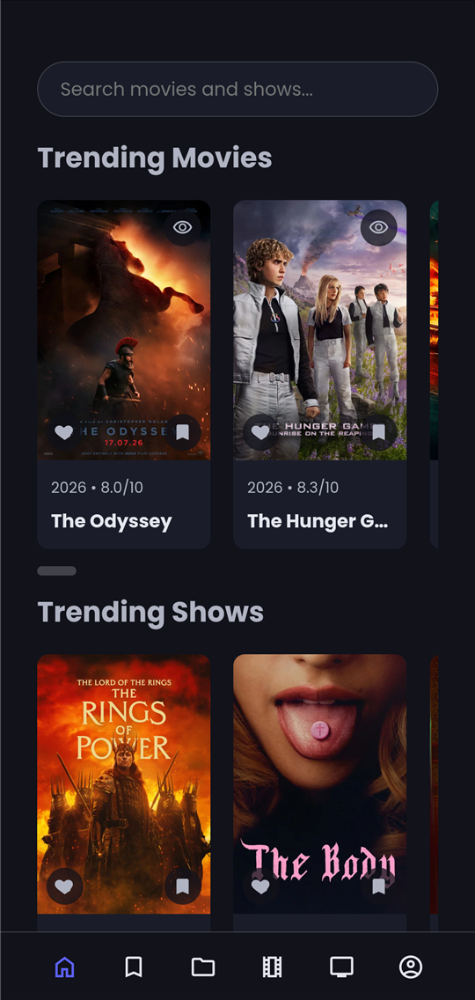
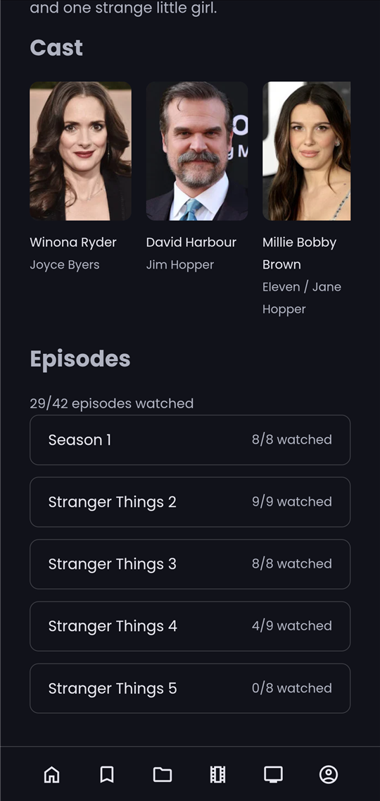
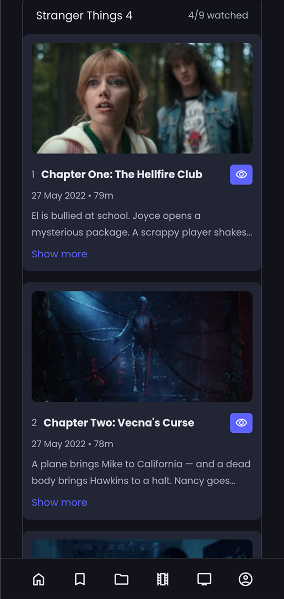
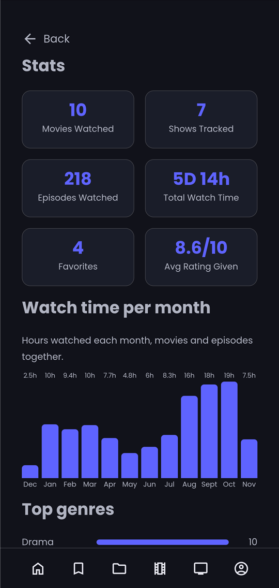

# Watchlog

**A free, private movie and TV show tracker for Android.** Keep track of every movie you've
watched and every episode of every show, see what's airing next, and get a notification when a
new episode comes out. No account, no ads, no subscription.

When TV Time shut down on 15 July 2026, I lost the app I used every day to keep track of my
shows, so I built my own replacement. Watchlog started as a personal project (and a way to learn),
and I'm sharing it in case it's useful to anyone else who misses TV Time. It's built around three
ideas:

- **Your data stays on your phone.** There's no sign-up and no server. Your watch history is
  stored only on your device, and nobody else ever sees it.
- **Free forever.** There's nothing to host or pay for. Movie and show information comes from
  [TMDB](https://www.themoviedb.org/) (The Movie Database), using a free personal key that each
  person gets for themselves (it takes a few minutes, see [step 1](#1-get-your-free-tmdb-key)).
- **No lock-in.** You can back up all your data to a file at any time, and restore it on another
  phone.

  
  
  
  

  <a href="https://github.com/EasyBuster200/Movie-and-Show-tracker-App/releases/latest/download/Watchlog.apk"><b>⬇ Download the latest Watchlog.apk</b></a>
  · <a href="https://github.com/EasyBuster200/Movie-and-Show-tracker-App/releases">All versions</a>

---

## Contents

- [What it can do](#what-it-can-do)
- [Install it](#install-it)
  - [1. Get your free TMDB key](#1-get-your-free-tmdb-key)
  - [2. Install the app](#2-install-the-app)
  - [3. Create your profile](#3-create-your-profile)
- [How to use it](#how-to-use-it)
- [Backups and moving to a new phone](#backups-and-moving-to-a-new-phone)
- [Updating the app](#updating-the-app)
- [Privacy](#privacy)
- [Troubleshooting](#troubleshooting)
- [For developers](#for-developers)
- [Credits and license](#credits-and-license)

---

## What it can do

- **Track movies and every episode of every show.** Mark a movie as watched with one tap. For
  shows, mark individual episodes; if you skip ahead, Watchlog offers to mark all the earlier
  episodes for you.
- **Keep Watching.** The shows you're in the middle of, so you always know what's next.
- **Airing Soon, with a calendar.** Every announced upcoming episode of the shows you follow,
  day by day, with a week strip on top so you can see what's coming at a glance.
- **New-episode notifications.** A notification at 6 pm on the day a new episode of one of your
  shows comes out. It works even if you don't open the app for a while.
- **Knows when you've moved on.** Shows you're caught up on wait quietly until new episodes come
  out. A show you haven't touched for a month after new episodes came out counts as *dropped*
  and leaves Keep Watching. Your full list of watched shows can be filtered by Watching,
  Caught up, Completed and Dropped.
- **Stats.** Total watch time, hours watched per month, your top genres and actors, how you
  rate things, and how far along you are in every show.
- **Browse and discover.** Trending, popular (in your country), coming soon, and recommendations
  based on what you've watched. Search finds movies, shows and actors; every actor has a page
  with their full filmography.
- **Bookmarks, lists, favorites and ratings.** Save anything for later, organise it into your
  own lists, mark favorites, and rate things out of 5 stars (half stars allowed).
- **Several people on one phone.** Each person gets their own profile with completely separate
  data.
- **Automatic weekly backups.** Every week your data is saved to a file on your phone, ready to
  restore if you ever reinstall or switch phones.

## Install it

Watchlog is an **Android** app (Android 5.1 or newer). There's no iPhone version.

Setting it up takes three steps: get a free TMDB key (about 5 minutes, once), install the app,
and create your profile.

### 1. Get your free TMDB key

Watchlog gets all its movie and show information from TMDB, and TMDB asks every app user to
have their own free key. Think of it as the app's "password" for talking to TMDB: you only
need it when you create your profile, and it's stored only on your phone.

1. **Create a free TMDB account** at [themoviedb.org/signup](https://www.themoviedb.org/signup),
   then open the confirmation email TMDB sends you and click the link in it.
2. **Log in** and go to [themoviedb.org/settings/api](https://www.themoviedb.org/settings/api)
   (you can also get there from your profile picture → **Settings** → **API**).
3. **Request an API key.** Click the link to create or request one, choose the **Developer**
   option, and accept TMDB's terms of use.
4. **Fill in the short form.** TMDB asks what you'll use the key for and for some contact
   details. For example:
   - Type of use: **Personal**
   - Application name: **Watchlog**
   - Application URL: `https://github.com/EasyBuster200/Movie-and-Show-tracker-App`
   - Application summary: *"Personal movie and TV tracker app on my phone."*
5. **Copy your token.** Back on the [API settings page](https://www.themoviedb.org/settings/api)
   you'll see two codes. You need the long one called **API Read Access Token** (it starts with
   `eyJ` and is a few hundred characters long), **not** the short "API Key".

> **Tip:** Send the token to yourself (email, a note, or a password manager) so you can paste it
> on your phone. Keep it private, like a password. If it ever leaks, you can generate a new one
> on the same TMDB page.

### 2. Install the app

1. **On your Android phone**, open this page and tap
   **[Download the latest Watchlog.apk](https://github.com/EasyBuster200/Movie-and-Show-tracker-App/releases/latest/download/Watchlog.apk)**.
   (Your browser may warn that the file could be harmful. That's a standard warning for any app
   that doesn't come from the Play Store; tap **Download anyway**.)
2. **Open the downloaded file**, from the download notification or from your **Files** /
   **Downloads** app.
3. **Allow installing apps.** The first time, Android says your browser (or Files app) isn't
   allowed to install apps. Tap **Settings**, turn on **Allow from this source**, and go back.
4. **Tap Install.**
5. **If Google Play Protect shows a warning** ("unsafe app" or "app scan recommended"), that's
   because Watchlog isn't published on the Play Store. Tap **More details** → **Install anyway**
   (the wording differs a little between phones). Watchlog's full source code is in this
   repository for anyone to check.

When it's done, Watchlog appears in your app list.

### 3. Create your profile

1. Open **Watchlog** and tap **+ New Profile**.
2. Enter your **name** and paste your **API Read Access Token** from step 1.
3. Tap **Create Profile**. Watchlog checks the token with TMDB first, and tells you if something
   is wrong (for example if you pasted the short "API Key" by mistake).
4. Tap your new profile to start.
5. The first time, Android asks whether Watchlog may send you notifications. Tap **Allow** if
   you want new-episode notifications (you can turn them off later).

## How to use it

The bar at the bottom of the screen has six tabs: **Home**, **Bookmarks**, **Lists**, **Movies**,
**TV Shows** and **Profile**.

### Find something

- **Search** with the search bar at the top of Home, Movies, TV Shows and most other pages. It
  finds movies, shows and actors as you type.
- **Home** shows what's trending today, plus *Airing Soon* for your shows.
- **Movies** and **TV Shows** have popular titles (in your country), recommendations based on
  what you've watched, and a browser you can filter by genre. Movies also has *Coming Soon*.
- Tap any poster to open its page: description, cast, rating, and, for shows, all the seasons and
  episodes. Tap a cast member to see everything else they've been in.

### Track what you watch

Every poster has three small buttons:

| Button | What it does |
| --- | --- |
| 👁 **Eye** (top right, movies) | Mark the movie as watched. Not available until it's released. |
| ♥ **Heart** (bottom left) | Add to your favorites. |
| 🔖 **Bookmark** (bottom right) | Save it to your Bookmarks or one of your lists. |

**For shows,** open the show's page and expand a season to see its episodes. Tap the eye on an
episode to mark it watched. If you mark an episode and earlier ones aren't watched yet,
Watchlog asks whether to mark those too, which is handy when you're adding a show you're
already halfway through. Episodes that haven't aired yet show as *Coming Soon*.

**Rate** anything from its page with the stars: tap the right half of a star for a full star,
or the left half for a half star.

### Keep up with your shows

- **Keep Watching** (on the **TV Shows** tab) lists the shows you're in the middle of. A small
  dot means a new episode has come out since you last watched.
- **Airing Soon** (on **Home**) shows the next episode of each show you follow. Tap
  **Calendar ›** for the full schedule: a strip of upcoming days on top (days with new episodes
  are marked; tap one to jump to it) and every announced episode listed below.
- **Notifications:** on the day a new episode airs, you get a notification at 6 pm. Tap it to
  open the show. Turn them on or off from **Profile → ⋮ menu → Episode Notifications**.

How Watchlog sorts your shows:

| Status | Meaning |
| --- | --- |
| **Watching** | There are episodes out that you haven't watched yet. |
| **Caught up** | You've watched everything that's out, and more is coming. These shows wait in *Airing Soon* until the next episode is out. |
| **Completed** | The show has ended and you've watched all of it. |
| **Dropped** | New episodes have been out for over a month and you haven't watched any. It leaves *Keep Watching*, but still appears in *Airing Soon* and still notifies you. Watching an episode brings it back. |

To see all your shows by status, go to **Profile → Watched Shows → View All** and use the
filters at the top.

### Bookmarks and lists

- **Bookmarks** is your quick "watch later" pile: tap the bookmark button on any poster and
  choose *Bookmarks*.
- **Lists** lets you make your own collections (e.g. "Christmas movies"). Create a list on the
  **Lists** tab, then add to it from any poster's bookmark button or from the search box inside
  the list.

### Your profile and stats

The **Profile** tab shows a summary of your stats and previews of your watched movies and shows
and your favorites (tap **View All** on any of them for the full list). Tap **Stats** for the full
stats page: hours watched each month, your top genres and actors, how you rate things, and your
progress in every show.

The **⋮ menu** at the top of your profile has:

- **Export Backup**: save or send a copy of your data (see [Backups](#backups-and-moving-to-a-new-phone)).
- **Back Up Now**: run the automatic backup immediately.
- **Episode Notifications: On/Off**.
- **Import Backup**: add a backup as a new profile.
- **Switch Account**: go back to the profile list.
- **Delete Account**: delete this profile and all its data from the phone.

### Several people on one phone

Each person can have their own profile, with their own name, TMDB key and completely separate
watch history. Use **Profile → ⋮ → Switch Account** to switch. Notifications follow whichever
profile is currently open.

## Backups and moving to a new phone

**Your data only exists on your phone.** If you uninstall Watchlog or lose your phone without a
backup, it's gone, so it's worth knowing how backups work.

- **Automatic weekly backup:** once a week, Watchlog saves a backup of each profile to the
  **Documents → Watchlog** folder on your phone (you can see it in your Files app). Only the
  newest one is kept. The weekly backup happens the next time you open the app after it's due;
  **Profile → ⋮ → Back Up Now** makes one immediately.
- **Manual backup:** **Profile → ⋮ → Export Backup** lets you send a copy anywhere: Google Drive,
  email, another phone, and so on. It's a good idea to keep a copy somewhere other than your
  phone.
- **Backups never contain your TMDB token,** so they're safe to keep in the cloud. When you
  restore one, you'll be asked for your token again.

**To restore a backup** (on a new phone, or after reinstalling):

1. Install Watchlog (see [Install it](#install-it)) and put the backup file on the phone, for
   example by downloading it from Drive.
2. Open Watchlog. On the profile screen, tap **Import Backup** and choose the file.
3. Paste your TMDB **API Read Access Token** and tap **Restore Backup**.

Restoring always creates a new profile. It never overwrites one you already have.

> **After reinstalling,** Android doesn't let the new install delete backup files made by the
> old one, so old files can pile up in **Documents → Watchlog**. Delete them yourself from the
> Files app whenever you like.

## Updating the app

When there's a new version, download the latest
**[Watchlog.apk](https://github.com/EasyBuster200/Movie-and-Show-tracker-App/releases/latest/download/Watchlog.apk)**
and install it the same way. It installs over the old version and **keeps all your data**. There's
no need to uninstall first. (Uninstalling deletes your data, so only do that after making a
backup.) You can see what changed in each version on the
[releases page](https://github.com/EasyBuster200/Movie-and-Show-tracker-App/releases).

## Privacy

- Watchlog has **no account and no server**. Everything you track is stored only on your phone.
- The only thing it connects to is **TMDB**, to get movie and show information and pictures,
  using your own token. Your watch history is never sent anywhere.
- There are **no ads, no analytics and no tracking** of any kind.
- Your TMDB token is stored only on your phone, inside the app, and is left out of every backup.

## Troubleshooting

**"TMDB rejected that key"**: make sure you copied the long **API Read Access Token**, all of
it, not the short "API Key". If Watchlog says it looks like the short API Key, go back to
[themoviedb.org/settings/api](https://www.themoviedb.org/settings/api) and copy the long one.

**"Couldn't reach TMDB"** or pages say "Failed to load…": check your internet connection.
Watchlog needs internet to fetch movie and show information (your own data is always available).

**I'm not getting notifications:**
- Check they're on: **Profile → ⋮ → Episode Notifications: On**.
- Check Android allows them: **Settings → Apps → Watchlog → Notifications**.
- Some phones stop apps from working in the background to save battery. If notifications don't
  arrive, set Watchlog's battery usage to **Unrestricted** in **Settings → Apps → Watchlog →
  Battery**.
- Notifications are only for shows where TMDB has announced the next episode's date. Check the
  **Airing Soon** calendar to see what's announced.

**The app won't install over my current version**: this happens if the APK wasn't from this
page (it was signed differently). Make a backup, uninstall, install the version from here, and
restore the backup.

**Something else?** [Open an issue](https://github.com/EasyBuster200/Movie-and-Show-tracker-App/issues)
on GitHub.

## For developers

Building it yourself, how it works under the hood, tests and releasing are covered in
**[docs/DEVELOPMENT.md](docs/DEVELOPMENT.md)**.

## Credits and license

Movie and show information and images come from [TMDB](https://www.themoviedb.org/). This product
uses the TMDB API but is not endorsed, certified, or otherwise approved by TMDB.

Watchlog is not affiliated with TV Time or Whip Media.

License: ISC.
